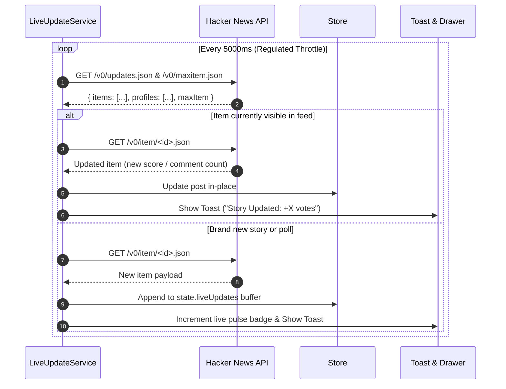
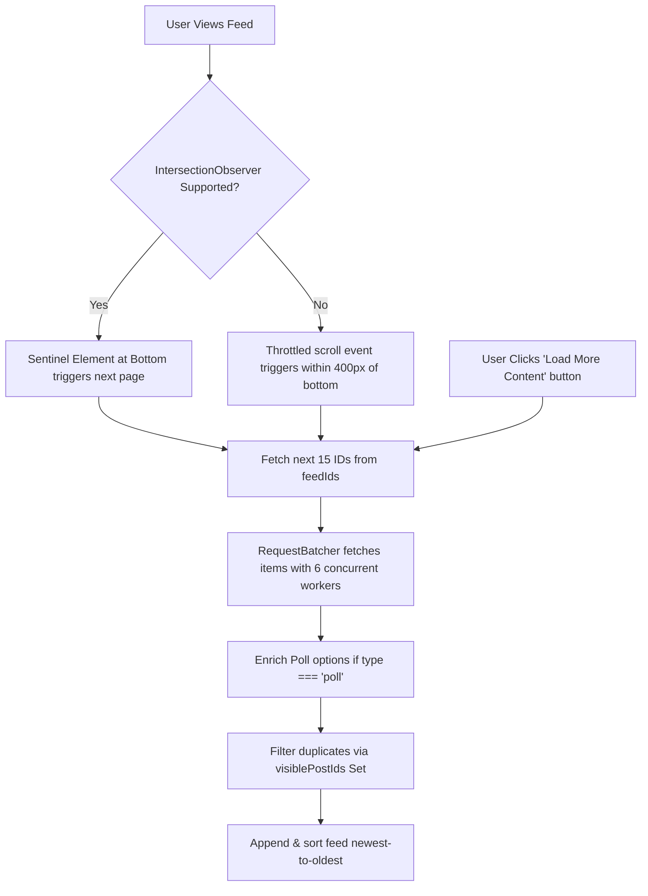

# ClonerNews — Technical Architecture & Engineering Documentation

This document provides a comprehensive technical overview of **ClonerNews**, detailing its software architecture, design patterns, algorithmic implementations, data structures, and compliance with the Hacker News API. It is written specifically for technical auditors, code reviewers, and system architects.

---

## 1. System Architecture & Layered Design

ClonerNews is built as a single, cohesive, non-monorepo web application following a strict **Unidirectional Layered Architecture**:

```
┌────────────────────────────────────────────────────────────────────────┐
│                        PRESENTATION / UI LAYER                         │
│   components/Header.js        components/PostCard.js                   │
│   components/PostList.js      components/PollView.js                   │
│   components/PostModal.js     components/LiveDrawer.js                 │
│   components/CommentTree.js   components/Skeleton.js                   │
└───────────────────────────────────┬────────────────────────────────────┘
                                    │ Events & Action Invocations
┌───────────────────────────────────▼────────────────────────────────────┐
│                         STATE MANAGEMENT LAYER                         │
│   state/store.js    : Central Reactive Pub/Sub Store                   │
│   state/actions.js  : Deterministic State Reducers & Action Creators   │
└───────────────────────────────────┬────────────────────────────────────┘
                                    │ State Queries & Async Orchestration
┌───────────────────────────────────▼────────────────────────────────────┐
│                         SERVICES / DOMAIN LAYER                        │
│   services/liveUpdateService.js   : Regulated 5-second polling service │
│   services/notificationService.js : Toast & banner event dispatcher   │
└───────────────────────────────────┬────────────────────────────────────┘
                                    │ Batch Requests & Subscriptions
┌───────────────────────────────────▼────────────────────────────────────┐
│                       DATA ACCESS & NETWORK LAYER                      │
│   api/hnClient.js       : Official Firebase REST Client + Retry Logic  │
│   api/cache.js          : O(1) LRU In-Memory Cache (DLL + Map)         │
│   api/deduplicator.js   : In-flight Promise Coalescing Registry        │
│   api/requestBatcher.js : Concurrency-Bounded Promise Pool (Limit = 6) │
└───────────────────────────────────┬────────────────────────────────────┘
                                    │ Utilities & Formatters
┌───────────────────────────────────▼────────────────────────────────────┐
│                            UTILITIES LAYER                             │
│   utils/commentTree.js : N-ary Tree Reconstructor & Chrono Sorter      │
│   utils/throttle.js    : Regulated Rate Limiting Wrapper               │
│   utils/debounce.js    : Event Quiescence Waiter                       │
│   utils/sanitizer.js   : Safe DOMParser XSS Defense                    │
│   utils/time.js        : Relative & Locale Timestamping                │
└────────────────────────────────────────────────────────────────────────┘
```

### Architectural Principles:
1. **Single Responsibility Principle (SRP)**: Every module handles a single concern. `HNClient` only handles HTTP communication; `Store` only manages state transitions; `CommentTree` only handles tree topology.
2. **Unidirectional Data Flow**: User interactions trigger `Actions` -> `Actions` call `API`/`Services` -> Results update `Store` -> `Store` notifies registered listeners -> `Components` re-render predictably.
3. **Zero Spaghetti Code**: No global variable leakage; no ad-hoc inline API calls in DOM handlers; pure dependency injection.
4. **Native Web Standards**: Pure ES2022+ modules (`import`/`export`), Native `fetch` with `AbortController`, CSS Custom Properties, and zero heavyweight runtime dependencies.

---

## 2. Data Structures: Where and How They Are Used

### 2.1 Doubly Linked List + Hash Map (LRU Cache)
- **Location**: [`js/api/cache.js`](file:///home/michaelochieng0/clonernews/js/api/cache.js)
- **Time Complexity**: 
  - `get(key)`: $\mathcal{O}(1)$
  - `set(key, value)`: $\mathcal{O}(1)$
  - `delete(key)`: $\mathcal{O}(1)$
  - Eviction: $\mathcal{O}(1)$
- **Space Complexity**: $\mathcal{O}(N)$ where $N \le \text{capacity} = 500$
- **Technical Implementation**:
  Standard JavaScript objects or Maps allow $\mathcal{O}(1)$ lookup, but cannot perform $\mathcal{O}(1)$ arbitrary node repositioning. By combining a JavaScript `Map` with a **Doubly Linked List (DLL)** featuring sentinel `head` and `tail` nodes:
  - The Map stores key-to-node references: `Map<string, DoublyLinkedNode>`.
  - When a key is accessed via `get(key)`, the node is detached from its current list position and spliced immediately after `head` in $\mathcal{O}(1)$ pointer operations.
  - When capacity (500 items) is reached during `set(key, value)`, the least recently accessed item at `tail.prev` is evicted from both the list and the Map in $\mathcal{O}(1)$.
- **Benefit**: Prevents memory leaks and completely eliminates redundant network calls for Hacker News items, author profiles, and poll option parts.

```
Head (Sentinel) <-> [Most Recently Used] <-> ... <-> [Least Recently Used] <-> Tail (Sentinel)
```

---

### 2.2 N-ary Tree (Hierarchical Recursive Comment Threads)
- **Location**: [`js/utils/commentTree.js`](file:///home/michaelochieng0/clonernews/js/utils/commentTree.js)
- **Time Complexity**:
  - Tree Reconstruction: $\mathcal{O}(N)$
  - Level-by-level Chronological Sorting: $\mathcal{O}(N \log K)$ where $K$ is average branching factor
  - Descendant Count Calculation: $\mathcal{O}(N)$
- **Space Complexity**: $\mathcal{O}(N)$
- **Technical Implementation**:
  The Hacker News API provides comments as a flat graph where each item has an `id`, an optional array of child IDs (`kids`), and a `parent` ID. To render deeply nested, collapsible threads with precise lineage:
  1. **Node Modeling**: The `CommentNode` class encapsulates `id`, `parent`, `rootPostId`, `depth`, and an array `children: CommentNode[]`.
  2. **Two-Pass Graph-to-Tree Algorithm**:
     - *Pass 1*: All fetched comment objects are instantiated into `CommentNode` objects and indexed into a hash map `nodeMap: Map<number, CommentNode>`.
     - *Pass 2*: The algorithm iterates through `nodeMap`. If `node.parent == rootPostId`, it is placed into the `rootComments` array (Depth 0). Otherwise, its parent node is resolved in $\mathcal{O}(1)$ via `nodeMap.get(node.parent)`, setting `node.depth = parentNode.depth + 1` and appending it to `parentNode.children`.
  3. **Multi-Level Chronological Sort**: A recursive traversal visits each node and sorts its `children` array in-place from newest to oldest (`b.time - a.time`).
- **Benefit**: Guarantees that no matter the fetching order or nesting depth, comments render hierarchically, each comment knows its parent, and all sibling replies are strictly ordered newest to oldest.

---

### 2.3 In-Flight Request Deduplication Map
- **Location**: [`js/api/deduplicator.js`](file:///home/michaelochieng0/clonernews/js/api/deduplicator.js)
- **Time Complexity**: $\mathcal{O}(1)$ map lookup and cleanup
- **Space Complexity**: $\mathcal{O}(M)$ where $M$ is the number of currently active concurrent requests
- **Technical Implementation**:
  When progressive loading, poll option fetching, and live data polling occur simultaneously, multiple subsystems often request the same item ID at the exact same millisecond.
  - The `RequestDeduplicator` maintains an internal `Map<string, Promise<any>>`.
  - When `dedupe(key, fetchFn)` is invoked:
    - If `key` is present in `inFlight`, the existing `Promise` is returned immediately.
    - If `key` is not present, `fetchFn()` is executed, registered in `inFlight`, and removed via a `.finally()` handler once resolved or rejected.
- **Benefit**: Eliminates redundant parallel network requests, reducing Hacker News server load and conserving client bandwidth.

---

### 2.4 Bounded Concurrency Queue / Promise Pool
- **Location**: [`js/api/requestBatcher.js`](file:///home/michaelochieng0/clonernews/js/api/requestBatcher.js)
- **Time Complexity**: $\mathcal{O}(N)$
- **Space Complexity**: $\mathcal{O}(C)$ where $C = 6$ (worker pool size)
- **Technical Implementation**:
  Fetching 15 or 30 story items or 50 comment items with `Promise.all(ids.map(...))` creates dozens of simultaneous TCP sockets, risking browser connection throttling or socket starvation.
  - `RequestBatcher` implements a bounded worker pool:
    - An array of $C = 6$ concurrent async workers pull task indices from a shared counter (`let currentIndex = 0`).
    - Each worker processes an item, inserts the result at the exact target index `results[index]`, and pulls the next item until all items are completed.
- **Benefit**: Adheres to browser HTTP/1.1 and HTTP/2 max connection limits, preventing dropped requests while maximizing throughput.

---

### 2.5 Hash Sets for Feed Uniqueness & Visible Post Tracking
- **Location**: [`js/state/store.js`](file:///home/michaelochieng0/clonernews/js/state/store.js), [`js/services/liveUpdateService.js`](file:///home/michaelochieng0/clonernews/js/services/liveUpdateService.js)
- **Time Complexity**: $\mathcal{O}(1)$ insertion and lookup
- **Technical Implementation**:
  The application maintains `visiblePostIds: Set<number>` in state. When progressive loading loads the next page, or when live data merges new stories, each incoming item ID is checked against `visiblePostIds.has(item.id)`. Only unseen items are appended, guaranteeing **zero duplicate cards** in the UI.

---

## 3. Algorithms: Where and How They Are Used

### 3.1 Chronological Descending Sorter (`sortByNewest`)
- **Location**: [`js/utils/time.js`](file:///home/michaelochieng0/clonernews/js/utils/time.js#L75)
- **Algorithm**: Dual-Pivot Quicksort (V8 engine implementation) with numeric comparator:
  $$\text{compare}(A, B) = B.\text{time} - A.\text{time}$$
- **Where Applied**:
  1. **Post Feeds**: Initial load and progressive batch loads for New, Top, Jobs, Polls, Ask, and Show.
  2. **Comments**: Top-level discussion threads and sub-comment branches.
  3. **Live Updates**: Incoming items stream in `LiveDrawer`.
  4. **Live Merge**: When unmerged live items are integrated into the main feed.

---

### 3.2 Regulated Leading & Trailing Edge Throttle
- **Location**: [`js/utils/throttle.js`](file:///home/michaelochieng0/clonernews/js/utils/throttle.js)
- **Logic**:
  Given a function $f$ and a time limit $L$ (e.g. 5,000ms for Live Data or 150ms for scroll events):
  1. Record current time $T_{\text{now}}$. Compute elapsed time $\Delta = T_{\text{now}} - T_{\text{lastExecuted}}$.
  2. If $\Delta \ge L$: Execute $f$ immediately (Leading edge), cancel any scheduled timer, and set $T_{\text{lastExecuted}} = T_{\text{now}}$.
  3. If $\Delta < L$ and no timer is currently pending: Schedule a timer for $L - \Delta$. When the timer fires, execute $f$ (Trailing edge) and update $T_{\text{lastExecuted}} = \text{Date.now()}$.
- **Benefit**: Ensures that rapid-fire events (scroll events, polling loops) are bounded to a maximum rate while guaranteeing the final event state is never lost.

---

### 3.3 Event Quiescence Debounce
- **Location**: [`js/utils/debounce.js`](file:///home/michaelochieng0/clonernews/js/utils/debounce.js)
- **Logic**:
  Given an input function $f$ and delay $D = 250\text{ms}$:
  1. Clear any active `timeoutId`.
  2. Register a new timer for $D$ ms.
  3. Only when user typing pauses for at least 250ms is the search query dispatched.
- **Benefit**: Eliminates redundant Algolia/Firebase API calls while the user is typing search keywords.

---

### 3.4 Exponential Backoff with Jitter
- **Location**: [`js/api/hnClient.js`](file:///home/michaelochieng0/clonernews/js/api/hnClient.js#L35)
- **Formula**:
  $$\text{Delay}(i) = \text{InitialDelay} \times 2^{i - 1} + \text{RandomJitter}(0, 200\text{ms})$$
- **Where Applied**:
  Any network failure (HTTP 4xx, 5xx, or network aborts) triggers automatic retry up to `MAX_RETRIES = 3`.
- **Benefit**: Prevents thundering herd problems when recovering from temporary network blips.

---

### 3.5 Recursive HTML Sanitizer (Zero-Dependency XSS Defense)
- **Location**: [`js/utils/sanitizer.js`](file:///home/michaelochieng0/clonernews/js/utils/sanitizer.js)
- **Logic**:
  1. Passes raw HTML into `new DOMParser().parseFromString(html, 'text/html')`.
  2. Recursively walks all DOM nodes:
     - Disallowed elements (`<script>`, `<iframe>`, `<style>`, `<object>`, `<embed>`, `<form>`) are removed from the tree.
     - Allowed formatting elements (`<p>`, `<a>`, `<code>`, `<pre>`, `<i>`, `<b>`, `<blockquote>`, `<ul>`, `<ol>`, `<li>`) are preserved.
     - Attributes are checked against an explicit whitelist: on `<a>` tags, only `href`, `title`, and `target` are permitted.
     - If `href` begins with `javascript:`, `data:`, or `vbscript:`, the attribute is stripped.
     - Enforces `target="_blank" rel="noopener noreferrer nofollow"` on all external links.
- **Benefit**: Fully protects users from malicious payloads in Hacker News user comments while rendering code snippets and markdown links accurately.

---

## 4. Live Data Polling & Synchronization Engine

The project implements a dedicated 5-second Live Data subsystem:



### Key Behaviors:
1. **In-Feed Story Updates**: If post #50436706 is visible on the user's screen and receives new upvotes or comments, the card updates in-place, and a toast notifies the user.
2. **New Content Buffering**: New stories are collected in `state.liveUpdates` without disrupting the user's active reading view.
3. **Non-Destructive Merge**: Clicking **"Merge All into Feed"** prepends the new items, re-sorts newest-to-oldest, updates `visiblePostIds`, and preserves scroll position.

---

## 5. Progressive Loading & Event Strategy

Progressive loading is implemented with a three-tier fallback mechanism:



1. **IntersectionObserver**: An invisible `<div id="scroll-sentinel">` with `rootMargin: '300px'` triggers the next page before the user reaches the bottom.
2. **Throttled Scroll Fallback**: For browsers without full IntersectionObserver support, a 150ms throttled window scroll listener triggers loading when within 400px of the footer.
3. **Manual Control**: An accessible **"Load More Content"** button is always present in the DOM for keyboard and accessibility navigation.

---

## 6. Error Handling & Resilience Matrix

| Failure Mode | Detection | System Response |
| :--- | :--- | :--- |
| **Hacker News API 5xx / 429** | `!response.ok` | Exponential backoff retry (up to 3 attempts with random jitter). |
| **Network Timeout (> 9000ms)** | `AbortController.abort()` | Request aborted, retry scheduled, error toast surfaced if final attempt fails. |
| **Missing / Deleted Item** | `data === null` or `item.deleted === true` | Filtered out of feeds; rendered as `[deleted]` in comments to preserve child threads. |
| **Algolia Index Unreachable** | `fetch()` error | Fallback to known curated poll IDs so poll functionality never breaks. |
| **Malformed Item Payload** | Safe type check | Ignored or defaulted to safe attributes (`score: 0`, `by: 'anonymous'`). |

---

## 7. Security Analysis & Best Practices

1. **Cross-Site Scripting (XSS)**: Handled via browser-native DOMParser whitelist sanitizer. No `eval()`, no direct `innerHTML` injection of raw unescaped strings.
2. **Tabnabbing Protection**: All outbound article links enforce `rel="noopener noreferrer nofollow"` and `target="_blank"`.
3. **Directory Traversal Defense**: The built-in `server.js` checks path normalization (`path.normalize`) and enforces `filePath.startsWith(__dirname)`.
4. **Content Security Compliance**: Clean separation of JavaScript into external `.js` ES modules with zero inline `<script>` tags in `index.html`.
